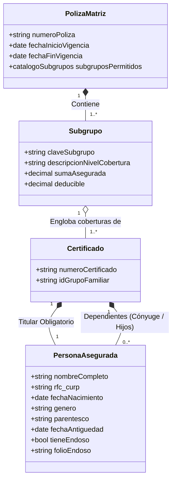
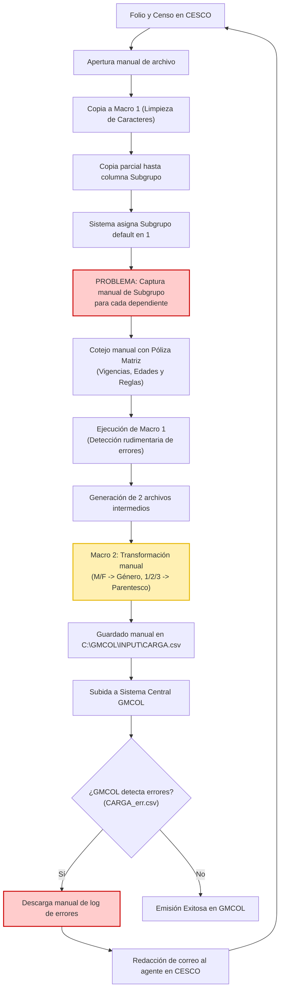
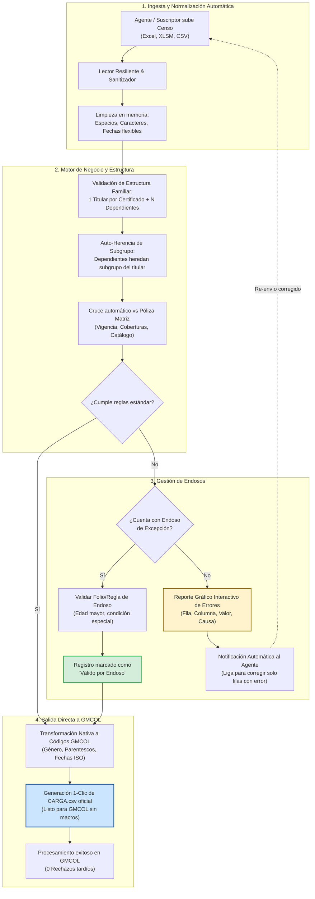
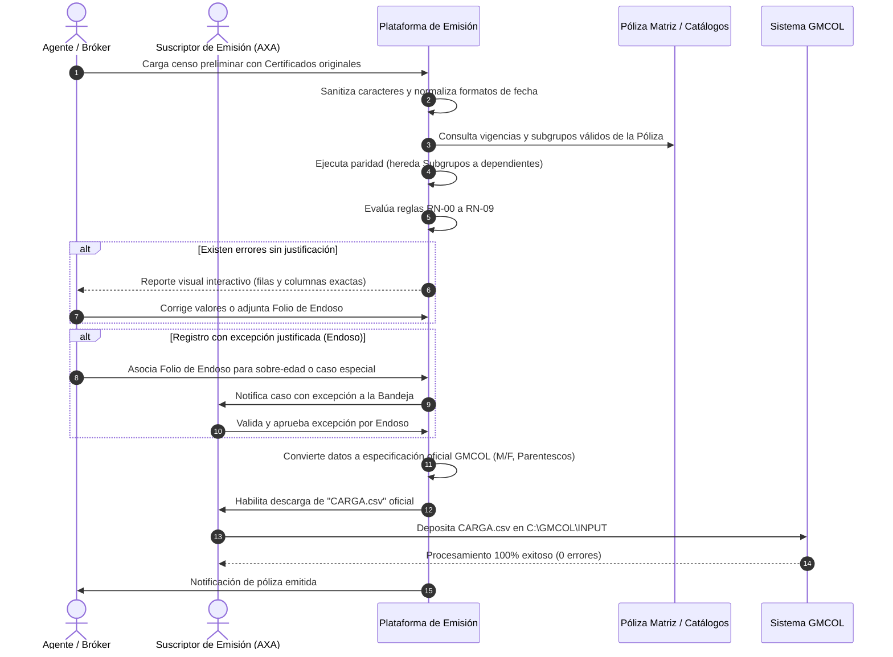
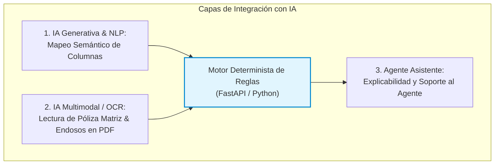
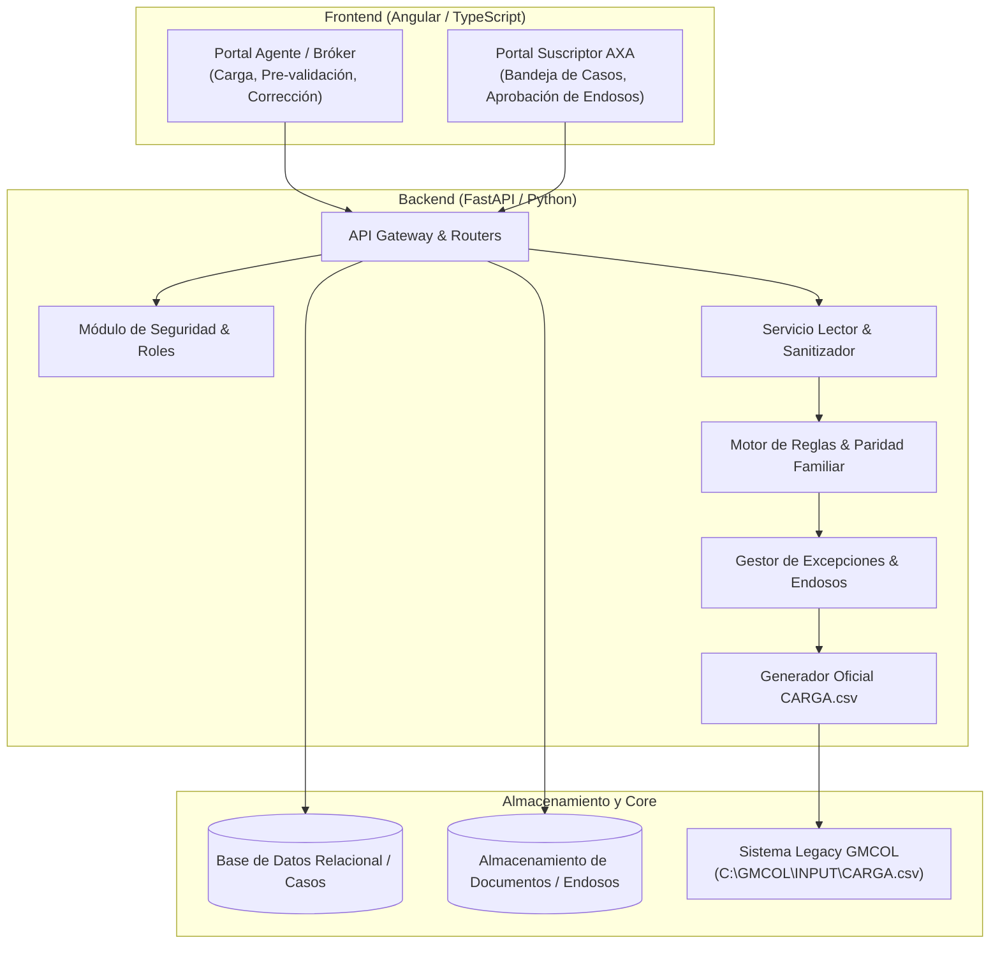

# Propuesta Integral de Aplicación: Plataforma Inteligente de Emisión de Pólizas (GMM y Colectividades)

> **Documento Estratégico y Técnico para el Departamento de Emisión de Pólizas — AXA Seguros**  
> **Estado:** Propuesta Técnica de Evolución (PoC a Producción)  
> **Fecha:** Octubre 2026  

---

## 1. Resumen Ejecutivo y Visión

El presente documento define la propuesta de solución definitiva para el **Departamento de Emisión de Pólizas**, evolucionando los resultados validados en la **Prueba de Concepto (PoC)** hacia una **Plataforma Web Integral de Emisión y Validación de Censos**.

### 1.1 El Problema Actual (Proceso Basado en Macros)
Actualmente, el proceso operativo de emisión y renovación depende de una cadena fragmentada de múltiples archivos de Excel y macros VBA que presentan serias ineficiencias:
1. **Fracaso recurrente por datos triviales:** Macros que se truncan o arrojan falsos errores por espacios en blanco adicionales, saltos de línea o caracteres especiales en nombres.
2. **Trabajo manual intensivo en Dependientes:** El sistema legacy no asocia dependientes con su respectivo titular, obligando a los operadores a capturar o ajustar manualmente los subgrupos de cobertura cónyuge por cónyuge e hijo por hijo.
3. **Rigidez de formatos para los Agentes:** Los agentes deben pelear con formatos exactos de fechas, códigos numéricos de parentesco y orden de registros, generando fricción comercial constante.
4. **Doble macro y conversión manual de archivos:** Los operadores deben copiar datos entre una macro de limpieza preliminar y una macro final para generar el archivo `CARGA.csv` en `C:\GMCOL\INPUT`.
5. **Detección tardía de errores en GMCOL:** Los errores reales no detectados por las macros saltan hasta el procesamiento central en GMCOL (`CARGA_err.csv`), detonando un bucle manual de correos y retrasos de varios días hábiles en CESCO.

### 1.2 La Visión de la Nueva Plataforma
Transformar el flujo en un **entorno digital unificado, resiliente y colaborativo**, donde:
* **Se erradiquen las macros y la manipulación de archivos intermedios.**
* **Los certificados originales de los asegurados se respeten y conserven íntegros** (garantizando continuidad a clientes provenientes de otras aseguradoras).
* **Los subgrupos se auto-hereden de forma inmediata a los dependientes** conforme al catálogo de la Póliza Matriz.
* **Los Endosos operen como habilitadores automáticos de excepción**, permitiendo procesar pólizas con casos especiales sin detener la emisión.
* **El archivo `CARGA.csv` se genere con 1 clic**, perfectamente homologado con las reglas de GMCOL para asegurar **0 rechazos tardíos**.

---

## 2. Modelo de Dominio y Reglas Estructurales

Con base en la operativa de negocio de AXA, la estructura del censo se rige bajo una jerarquía estricta pero flexible:

### 2.1 Principios Estructurales Mandatorios

1. **Un grupo familiar pertenece a un Certificado:**  
   El Certificado es la unidad que agrupa al titular y a sus familiares asociados.
2. **Cada Certificado tiene SIEMPRE un Titular (y solo uno):**  
   No existen certificados huérfanos. No se permite más de un titular dentro de un mismo certificado.
3. **Dependientes ($0..N$) vinculados al Titular:**  
   Un certificado puede tener desde cero hasta múltiples dependientes (máximo un cónyuge registrado y múltiples hijos/beneficiarios).
4. **El Subgrupo es el Diferenciador de Cobertura (1 Subgrupo $\rightarrow$ N Certificados):**  
   El subgrupo no representa personas ni certificados; representa el paquete de beneficios y condiciones contratadas en la Póliza Matriz (e.g., *Directivos*, *Operativos*, *Planta*). Distintos certificados pueden compartir el mismo subgrupo.
5. **Auto-Asignación de Subgrupos por Paridad:**  
   El sistema asigna y valida el subgrupo a nivel titular contra el catálogo de la Póliza Matriz, e **inmediatamente todos los dependientes pertenecientes a ese certificado heredan el mismo subgrupo automáticamente**, eliminando por completo la captura manual que hoy padecen los operadores.
6. **Inmutabilidad del Número de Certificado:**  
   El identificador del certificado provisto por el agente se conserva exactamente como viene en el censo. Esto protege el antecedente histórico de colectividades que migraron desde otras compañías de seguros y necesitan preservar sus folios preexistentes.

---

## 3. Comparativa de Flujos: Proceso Actual vs. Plataforma Propuesta

### 3.1 Proceso Actual (*As-Is*) — Fragmentado y Manual

---

### 3.2 Proceso Propuesto (*To-Be*) — Automatizado y en Plataforma Unificada

---

## 4. Diagrama de Secuencia de Interacción entre Actores

El siguiente diagrama detalla cómo interactúan el Agente, el Suscriptor interno, la Plataforma y el sistema central GMCOL:

---

## 5. Módulos Funcionales de la Solución Final

### Módulo 1: Motor de Ingesta Inteligente y Normalización
* **Independencia absoluta de macros:** Procesamiento directo en backend mediante servicios de alta velocidad.
* **Tolerancia a formatos:**
  * Reconocimiento de fechas en formatos DD/MM/AAAA, AAAA-MM-DD, con/sin hora, marcas de tiempo de Excel y variantes textuales.
  * Sanitización automática de cadenas: remoción de espacios dobles/triples, tabs invisibles, tildes desconfiguradas y caracteres corruptos que actualmente congelan las macros.
* **Preservación estricta de Certificados:** El certificado provisto por el agente se almacena como dato protegido, respetando la estructura original del cliente.

### Módulo 2: Motor de Paridad Familiar y Subgrupos Automáticos
* **Agrupamiento familiar por Certificado:** Identifica de forma autónoma el núcleo familiar. Si los registros vienen desordenados en el Excel, la plataforma los vincula por el número de certificado.
* **Validación de Titular Único:** Confirma que exista uno y solo un titular por certificado.
* **Propagación del Subgrupo:** Una vez determinado el subgrupo del titular conforme a la Póliza Matriz, el motor asigna automáticamente el mismo código de subgrupo a todos sus dependientes.

### Módulo 3: Motor de Endosos y Reglas de Excepción
* **Fin del rechazo ciego:** En la PoC actual, un asegurado mayor de 64 años en póliza nueva o mayor de 70 años en renovación es bloqueado como error rígido.
* **Modelo de Excepción Autorizada:**
  * Si el registro sobrepasa la regla pero cuenta con un **Endoso de Excepción**, el sistema no detiene la carga.
  * El agente o suscriptor introduce el número de endoso y tipo de cobertura autorizada.
  * La plataforma registra la auditoría y permite que el registro sea incorporado en el lote de emisión con el estatus `Aceptado con Endoso`.

### Módulo 4: Generador Oficial para GMCOL (`CARGA.csv`)
* **Eliminación de la Macro 2:** No más manipulación manual de cabeceras ni guardado artesanal de archivos.
* **Traducción nativa de catálogos:**
  * Género: Homologación automática entre (`M` / `F`) y (`Masculino` / `Femenino`).
  * Parentesco: Mapeo exacto entre descripciones textuales y códigos numéricos de GMCOL (`1` = Titular, `2` = Cónyuge, `3` = Hijo/a, etc.).
* **Generación en 1 clic:** Descarga directa de `CARGA.csv` con encoding, separadores y formato de columnas listos para depositarse directamente en `C:\GMCOL\INPUT`.
* **Cero rechazos en GMCOL:** Las validaciones de la plataforma replican al 100% las condiciones de rechazo de GMCOL, garantizando que si el archivo fue validado en la plataforma, pasará limpio por el core de emisión.

### Módulo 5: Bandeja de Trabajo y Notificación al Agente
* **Portal del Suscriptor:** Bandeja para monitorear lotes por folio CESCO, estatus del censo, volumen de asegurados y autorizaciones pendientes.
* **Bucle de auto-corrección para el Agente:** Cuando un censo requiere corrección, el agente recibe una alerta con acceso a una vista filtrada donde **únicamente visualiza las celdas con conflicto**, permitiéndole corregir directamente en pantalla o resubir únicamente el renglón observado sin alterar el resto de la población.

---

## 6. Evolución Estratégica con Inteligencia Artificial

La decisión tomada en la PoC de mantener una lógica determinista fue indispensable para garantizar la confiabilidad regulatoria y de cálculo. Hacia la versión final, la **Inteligencia Artificial se incorpora en las capas periféricas donde hoy existe mayor fricción humana**:

1. **Mapeo Semántico de Censos Heterogéneos (NLP):**
   * Los agentes suelen nombrar las columnas según su propio criterio (*"F. Nac"*, *"Fecha Nacimiento"*, *"Nacimiento_Titular"*).
   * Un modelo LLM liviano analiza los encabezados y sugiere o auto-mapea la estructura al estándar AXA antes de validar, eliminando la necesidad de obligar al agente a usar un layout inflexible.
2. **Extracción Automatizada de Pólizas Matrices y Endosos (OCR / Visión):**
   * En lugar de que el operador consulte manualmente en CESCO la carátula de la póliza para teclear la vigencia y los subgrupos, un modelo multimodal procesa el PDF de la póliza matriz y extrae las reglas específicas aplicables a ese colectivo.
   * Analiza cartas de endoso en PDF para validar automáticamente si el endoso cubre formalmente a la persona que presenta la excepción.
3. **Asistente de Explicabilidad para el Agente:**
   * Sustituye mensajes crípticos de error por explicaciones claras en lenguaje de negocio:  
     *Ejemplo:* *"El dependiente Roberto Gómez (Certificado 4021) tiene 26 años. Para conservarlo en la póliza familiar se requiere adjuntar constancia de estudios o número de endoso de extensión de edad."*

---

## 7. Arquitectura Tecnológica Recomendada

* **Frontend:** Angular 18+ con componentes modulares, diseño corporativo AXA, carga optimizada mediante Web Workers para censos masivos (más de 15,000 registros).
* **Backend:** FastAPI con Python 3.12, procesamiento vectorial de datos con Pandas/Polars para tiempos de respuesta menores a 3 segundos en censos de alta densidad.
* **Persistencia y Trazabilidad:** Base de datos relacional para control de folios CESCO, bitácora de auditoría y almacenamiento de documentos probatorios de endosos.
* **Seguridad:** Autenticación institucional AXA (SSO/OAuth2), roles segregados (Agente vs. Suscriptor) y cifrado de datos personales conforme a normativas de protección de datos (LFPDPPP).

---

## 8. Matriz de Valor y Retorno para el Negocio

| Dimensión | Proceso Actual (Macros + GMCOL) | Con la Plataforma Propuesta | Impacto para AXA |
| :--- | :--- | :--- | :--- |
| **Tiempo de procesamiento por censo** | De 3 a 5 días hábiles en reprocesos. | **Menos de 15 minutos** de punta a punta. | **-90% en tiempo de ciclo de emisión.** |
| **Captura de Subgrupos en Dependientes** | 100% manual fila por fila. | **100% automatizado** por herencia de titular. | Erradicación de errores humanos y fatiga operativa. |
| **Integridad de Certificados** | Riesgo de sobreescritura o desfase. | **Preservación total** del identificador del agente. | Fidelización de clientes provenientes de la competencia. |
| **Rechazos tardíos en GMCOL** | Frecuentes (`CARGA_err.csv`). | **Cero rechazos:** paridad previa de reglas. | Emisión limpia y sin re-trabajo. |
| **Tratamiento de Excepciones** | Conversaciones informales por correo. | **Flujo auditable de Endosos** integrado en sistema. | Gobernanza y trazabilidad técnica aseguradora. |
| **Experiencia del Agente** | Frustración por rechazos sin detalle. | Portal interactivo con corrección guiada. | Ventaja competitiva comercial para AXA. |

---

## 9. Próximos Pasos de Implementación

1. **Socialización de la Propuesta:** Presentar este documento conceptual a los líderes de Emisión y Operaciones.
2. **Definición de Diccionario GMCOL:** Homologar la matriz exacta de columnas, delimitadores y formatos esperados por `CARGA.csv`.
3. **Consolidación del Catálogo de Pólizas Matrices:** Establecer el mecanismo de consulta de vigencias y subgrupos permitidos.
4. **Pase a Producción del Módulo de Endosos y Exportador:** Incorporar las nuevas pantallas en el Portal de Suscriptor y liberar la versión 1.0 productiva.

